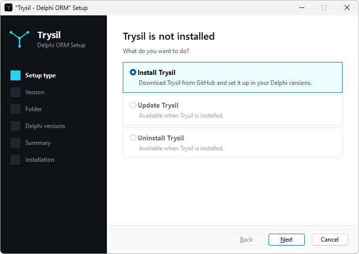
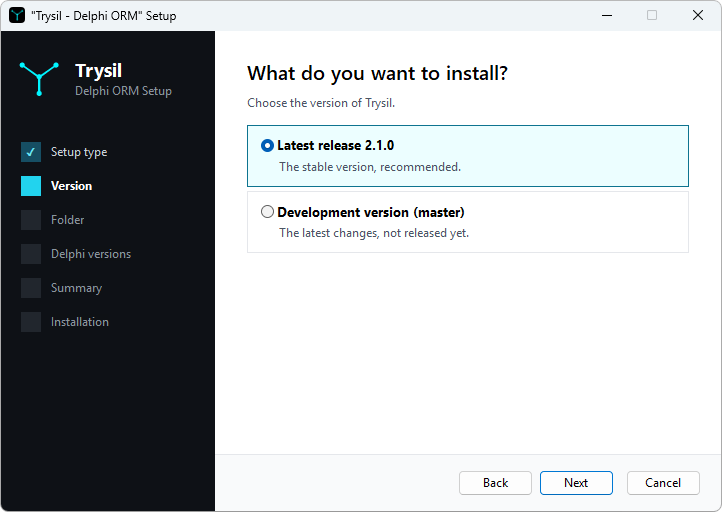
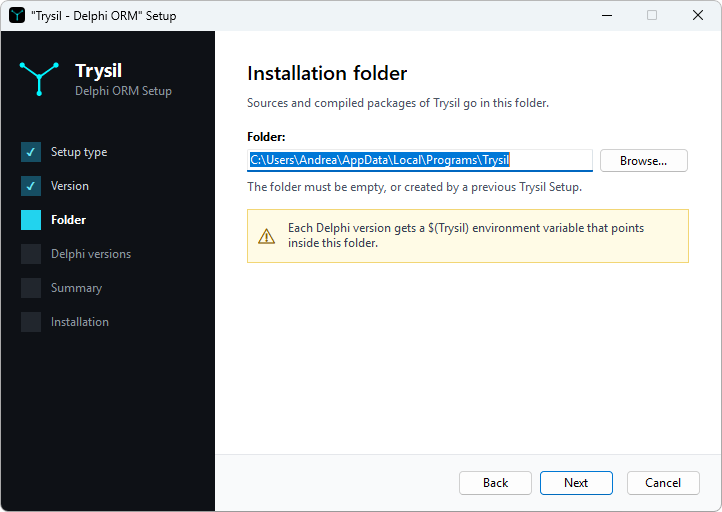
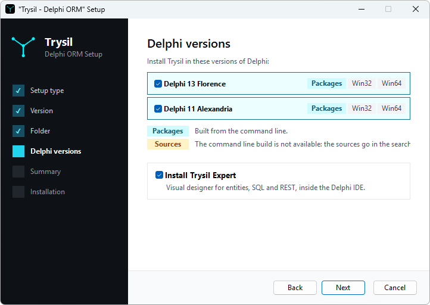
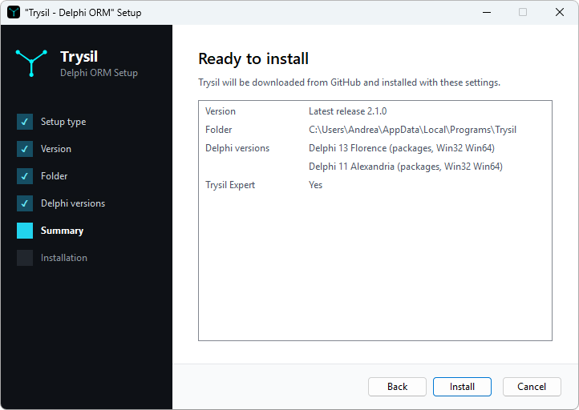
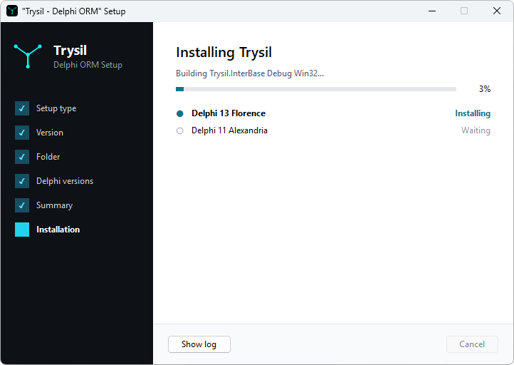
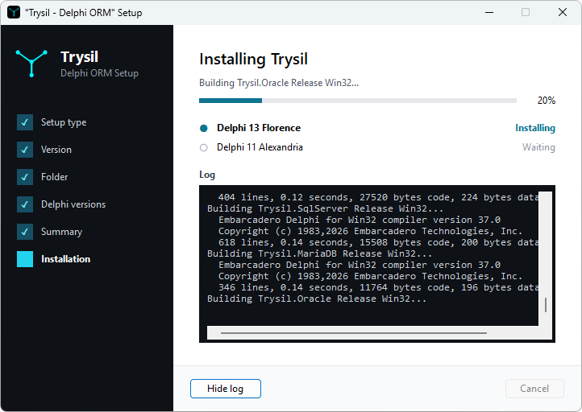
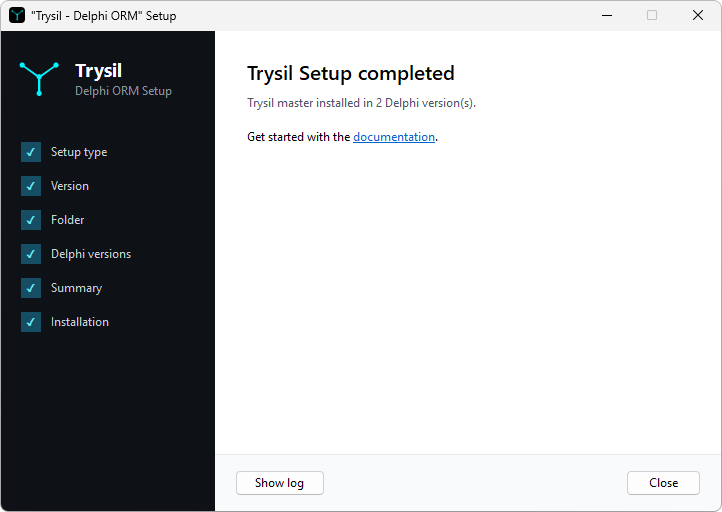
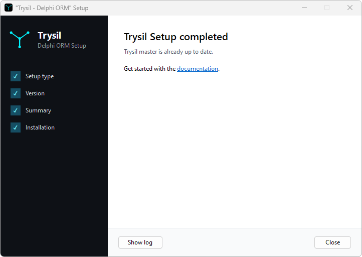

# Setup Program

The setup program installs Trysil in the Delphi versions on your machine: it
downloads the sources from GitHub, builds the packages and sets up the IDE. The
same program updates Trysil and uninstalls it.

## Download and Run

Download [Trysil.Setup.exe](https://www.lastrucci.net/trysil/Trysil.Setup.exe)
and run it with Delphi closed: if an instance of the IDE is running, the setup
asks you to close it before it starts.

The setup runs as the user, without administrator rights, and writes only
under `HKEY_CURRENT_USER`. Its source is in `Trysil.Setup` in the repository.

If you prefer not to run a downloaded executable, build the setup yourself: in
a clone of the repository open `Trysil.Setup\Trysil.Setup.dproj` with Delphi
13, build it for Win32 in the Release configuration and run
`Trysil.Setup\Win32\Release\Trysil.Setup.exe`. It needs nothing but the
repository, no Trysil package. An executable you build yourself does not
trigger the SmartScreen warning.

!!! note "The setup is not signed"
    The first time you run it, Windows SmartScreen shows *Windows protected
    your PC*. Click **More info**, then **Run anyway**.

## Install

### Setup type

When Trysil is not installed, the only choice is **Install Trysil**. The other
two, **Update Trysil** and **Uninstall Trysil**, are available once Trysil is
installed.

### Version

**Latest release** installs the latest Trysil release published on GitHub; its
number is read when the setup starts. **Development version (master)** installs
the current `master` branch, with the latest changes not released yet.

### Folder

The sources and the compiled packages go in this folder, by default
`%LOCALAPPDATA%\Programs\Trysil`. The folder must be empty, or created by a
previous run of the setup.

### Delphi versions

The setup lists the Delphi versions installed on the machine, each with the
platforms it can build, Win32 and Win64. A version is listed only if the IDE
has been started at least once, so that its options file exists.

Each version shows how Trysil is installed there:

- **Packages**: the setup builds the packages from the command line;
- **Sources**: the edition cannot build from the command line, as in the
  Community edition, so the setup puts the source folders in the library path
  and the IDE compiles them with your project.

**Install Trysil Expert** builds and registers the [Trysil
Expert](../tooling/expert/index.md). It is shown only when at least one
version builds the packages.

### Summary

The summary lists the choices. **Install** starts the installation.

### Installation

The bar shows the progress of the whole installation, and the list below it the
state of each Delphi version: **Waiting**, **Installing**, **Done** or
**Failed**.

**Show log** shows what the setup is doing, build by build:

The log is also saved as `Setup.log` in the installation folder.

### Completed

When every version is installed, the setup links to this documentation. When a
version fails while others succeed, the title reads **completed with errors**;
when nothing could be installed, it reads **failed**. In both cases the page
links to the log, which says what went wrong.

## What the Setup Changes

For each Delphi version, the setup:

1. builds the packages with MSBuild, Debug and Release, for Win32 and Win64
   where the platform is installed; `Trysil.SqlServer` and `Trysil.Oracle` are
   skipped where their FireDAC driver is not there (it ships only with the
   Enterprise and Architect editions);
2. sets the `Trysil` environment variable of the IDE to the `Lib\<ver>` folder
   of the installation, and adds `$(Trysil)\$(Platform)\Release` to the library
   path;
3. builds the Trysil Expert and registers it, if **Install Trysil Expert** is
   ticked.

On a **Sources** version nothing is built: `Trysil` points to the installation
folder and the library path lists the source folders.

The `Trysil` variable is set for both the 32-bit and the 64-bit IDE. Entries of
the library path that use `$(Trysil)` are replaced, so running the setup again
does not duplicate them.

!!! warning "A Trysil configured by hand"
    The setup owns the `Trysil` variable, the library path entries that use
    `$(Trysil)` and the `Trysil` entry of the IDE experts. If you set them up
    by hand, for example for a clone of the repository you build yourself, the
    installation replaces them with its own, and uninstalling removes them,
    yours included. To go back to your configuration, set them again after
    uninstalling.

!!! note "Custom IDE profiles"
    The setup configures the standard profile of each IDE, under
    `HKEY_CURRENT_USER\Software\Embarcadero\BDS`. A profile started with
    `bds -r <name>` lives under a key of its own, and the setup leaves it
    alone: there, set the `Trysil` variable, the library path and the Expert
    by hand, as described in [Installation](installation.md).

Finally the setup registers Trysil in the installed apps of Windows, with the
choices you made.

## Update

Run the setup again, or open it from the installed apps of Windows, and choose
**Update Trysil**. The update keeps the folder, the Delphi versions and the
Expert choice of the installation; it asks only for the version, the latest
release or `master`.

When the installed version is already the latest one, the setup stops without
downloading anything:

For `master` the setup compares the commit: it updates only when `master` has
moved since the installation.

The update downloads and builds in a separate folder next to the installation.
Only when every Delphi version succeeds does it replace the installed folder;
if a version fails, it discards the new folder and leaves the installation as
it was.

!!! note "A Delphi version installed later"
    The update works on the Delphi versions chosen at installation. To add
    Trysil to a Delphi version installed afterwards, uninstall Trysil and
    install it again.

## Uninstall

Choose **Uninstall Trysil**. For each Delphi version of the installation the
setup removes the library path entries that use `$(Trysil)`, the `Trysil`
variable and the Expert; then it deletes the installation folder and removes
Trysil from the installed apps of Windows.
